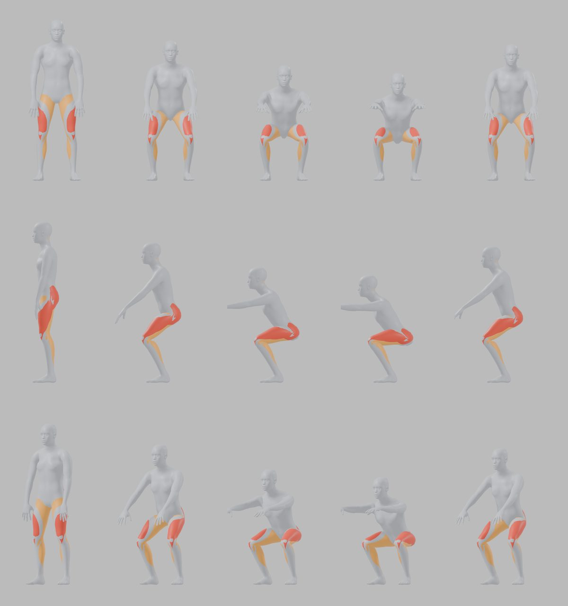

# Fitness Automation

A Blender pipeline that builds a library of 3D exercise animations: short looping
clips of correct form, with the worked muscles highlighted (primary in red, secondary
in orange) and real gym equipment such as barbells, dumbbells, cable stations,
benches and machines.



The output feeds a fitness app (tap a muscle on a body map, see the exercises that
train it) and short-form video. The first release covers 30 exercises, each one
QA-gated and approved by a human reviewer before it ships.

## How it works

| Stage | What happens |
|---|---|
| **Body** | An [MPFB2](https://static.makehumancommunity.org/mpfb.html) human (CC0), male and female, posed by a rule-based solver rather than mocap |
| **Muscles** | 17 muscle groups baked from [Z-Anatomy](https://www.z-anatomy.com/) onto the skin as masks |
| **Motion** | One JSON spec per exercise in `motion/specs/` (pattern, tempo, stance, grip, props, cameras), built from shared pattern families: standing hinge, split stance, overhead press, row, arm isolation, cable, seated, lying, floor, hanging support |
| **Equipment** | Procedural barbells, dumbbells, cable stacks, benches and machines with contact points the hands, feet and pads lock onto |
| **QA** | Every frame is checked for floor contact, hand-to-handle gaps, seat and pad contact, and clothing deformation; a failed check stops the export |
| **Delivery** | 720×900 H.264 and HEVC loops, WebP posters and thumbnails, and a manifest for the app |
| **Review** | A local review page shows every view of an exercise; approval is recorded per version in `approvals/` |

## Layout

| Path | Contents |
|---|---|
| `core/` | Body, pose solver, look, studio, render, delivery and review server |
| `motion/` | Motion pattern families and per-exercise specs |
| `equipment/` | Procedural equipment and machine contact rigs |
| `catalog/` | Exercise metadata: muscles, steps, cues, common mistakes, breathing |
| `bodymap/` | Front and back muscle maps (SVG + WebP) for the app's muscle picker |
| `qa/` | Form, contact and deformation checks, with golden reference sheets |
| `approvals/` | Version-bound review records |
| `research/` | Sources, licences and feasibility results |
| `prototypes/` | The first feasibility scripts, kept for reference |

## Requirements

- Blender 5.2 with MPFB2 2.0.18, installed in a project-local profile at
  `.blender-profile/` (`build.py` sets `BLENDER_USER_RESOURCES` automatically)
- Python 3 and FFmpeg

The large third-party assets (Z-Anatomy, MPFB packs) are not committed;
[research/FINDINGS.md](research/FINDINGS.md) lists where to download each one and
its licence.

## Usage

```sh
python3 exercises.py status                      # library state
python3 exercises.py preview barbell_back_squat  # quick contact sheet
python3 exercises.py render barbell_back_squat   # full QA + app media
python3 core/review_server.py 8765               # review and approve
```

[The exercise workflow](docs/EXERCISE_WORKFLOW.md) covers revisions, adding new
exercises, targeted exports, version-bound approval and release checks.

## Third-party assets

Body and hair assets are CC0 (MPFB2); muscle highlights derive
from Z-Anatomy / BodyParts3D and keep their attribution in
[assets/maps/LICENSE.md](assets/maps/LICENSE.md). Muscle classifications come from
[free-exercise-db](https://github.com/yuhonas/free-exercise-db) (Unlicense).

## Author

Oktay Shakirov
